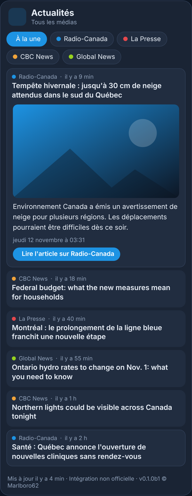

# Actualités Canada pour Home Assistant

<p>
  ☕ <strong>Si cette carte vous est utile, vous pouvez soutenir le projet :</strong>
</p>

<div style="white-space: nowrap; line-height: 0;">
  <a
    href="https://www.buymeacoffee.com/Marlboro62"
    target="_blank"
    rel="noopener noreferrer"
    style="display: inline-block; text-decoration: none; vertical-align: middle;"
  ></a>&nbsp;&nbsp;<a
    href="https://ko-fi.com/M4M2QL45X"
    target="_blank"
    rel="noopener noreferrer"
    style="display: inline-block; text-decoration: none; vertical-align: middle;"
  ></a>
</div>

Intégration et carte **non officielles** pour suivre l'actualité des **médias canadiens**, du **Québec** et **anglophones**, depuis votre tableau de bord : **Radio-Canada**, **La Presse**, **CBC News**, **Global News** et d'autres au choix. La carte affiche les **titres** ; un clic sur un titre **déroule l'image et le résumé** publiés par le média, avec un bouton vers l'article complet sur son site. Elle signale aussi les **Alertes AMBER** émises au Canada.

> Ce projet n'est affilié à aucun des médias cités, ni au système En Alerte. Il lit leurs **flux publics** (titre, résumé, image, date), comme un lecteur de flux. Les articles et leur contenu appartiennent à chaque média : l'article complet se lit sur son site.

🎮 **[Essayer la démo en ligne](https://marlboro62.github.io/news-ca-card/docs/demo.html)** : la vraie carte avec des titres et des résumés fictifs, sans installer Home Assistant (bleu nuit ou clair, et **simulation d'une Alerte AMBER fictive** pour voir la fenêtre d'alerte).

<p align="center">
  
</p>

<p align="center"><em>Capture de la démo : titres et résumés fictifs.</em></p>

## Fonctionnalités

- **Onglets par média** et onglet **À la une**, qui mélange tous les médias du plus récent au plus ancien.
- **Clic sur un titre** : l'image, le résumé, la date et le bouton **Lire l'article sur …** se déroulent ; un second clic replie l'article.
- **Voir plus** en bas de la liste pour afficher les titres suivants.
- **Un capteur par média** (nombre d'articles lus, articles en attributs), sans historique dans la base de Home Assistant.
- **Flux en panne** : la carte le signale et garde les derniers titres lus ; les autres médias continuent de s'afficher.
- **Alerte AMBER** : fenêtre d'alerte sur toutes les vues de Home Assistant quand une alerte est en cours (voir plus bas).
- **Thème** bleu nuit (par défaut), clair automatique ou thème de Home Assistant.

## 🚨 Alerte AMBER

L'intégration surveille **en permanence** le flux public du système national d'alerte **En Alerte** (Alert Ready, NAAD), qui diffuse les alertes officielles au Canada, dont les **Alertes AMBER**.

- Le flux est lu **toutes les 5 minutes**, indépendamment de la fréquence de lecture des médias, avec un second serveur si le premier ne répond pas.
- Une alerte est **en cours** tant qu'une Alerte AMBER réelle (pas un test) n'est ni expirée ni annulée. Les autres alertes (météo, etc.) sont ignorées.
- Le capteur `binary_sensor.actualites_canada_alerte_amber` passe à **on**, avec en attributs le titre, la description, la région, l'expiration et l'organisme émetteur : utilisable dans vos automatisations (notification, annonce vocale…).
- Une **fenêtre d'alerte** bilingue s'ouvre par-dessus Home Assistant, **sur toutes les vues et tous les appareils**, même sans la carte affichée. Elle n'est **pas désactivable** : **J'ai pris connaissance** la ferme pour cette alerte, sur cet appareil.
- La carte affiche aussi un **bandeau rouge** tant que l'alerte est en cours.

> Si vous avez une information sur une Alerte AMBER en cours, **composez le 911** et n'intervenez pas vous-même. Les sources officielles restent le système En Alerte, les corps de police et les médias.

## Médias proposés

| Média | Langue | Flux lu |
| --- | --- | --- |
| Radio-Canada | français | Grands titres |
| La Presse | français | Actualités |
| Le Devoir | français | Manchettes |
| TVA Nouvelles | français | Actualités |
| Le Journal de Montréal | français | Actualités |
| CBC News | anglais | Top stories |
| Global News | anglais | Actualités |
| The Globe and Mail | anglais | Canada |

Radio-Canada, La Presse, CBC News et Global News sont cochés par défaut. Vous pouvez aussi **ajouter n'importe quel flux RSS ou Atom** (un média régional, un blog) dans les options : une ligne par flux, de la forme `Nom | https://adresse-du-flux`.

> Un média peut changer l'adresse de son flux. Si un onglet affiche « Flux indisponible », [ouvrez une issue](https://github.com/Marlboro62/news-ca-card/issues) : en attendant, ajoutez la nouvelle adresse dans **Autres flux RSS**.

## Installation

### Avec HACS (dépôt personnalisé)

1. Ouvrez **Paramètres › Marketplace** (ou **HACS** avant la 2026.11), menu **⋮ › Dépôts personnalisés**.
2. Ajoutez `https://github.com/Marlboro62/news-ca-card`, catégorie **Intégration**.
3. Installez **Actualités Canada**, puis **redémarrez Home Assistant**.
4. **Paramètres › Appareils et services › Ajouter une intégration › Actualités Canada** : cochez les médias à suivre.
5. **Rechargez la page** du navigateur (Ctrl+F5) : la carte **Actualités Canada** apparaît dans la liste des cartes. Aucune ressource à ajouter, l'intégration charge la carte elle-même.

### Manuellement

Copiez le dossier `custom_components/news_ca` dans le dossier `config/custom_components` de Home Assistant, redémarrez, puis suivez les étapes 4 et 5.

## Options de l'intégration

**Paramètres › Appareils et services › Actualités Canada › Configurer**

| Option | Rôle | Défaut |
| --- | --- | --- |
| Médias suivis | Un capteur par média coché ; un média décoché voit son capteur supprimé | Radio-Canada, La Presse, CBC News, Global News |
| Autres flux RSS | Une ligne par flux : `Nom \| https://adresse-du-flux` | (vide) |
| Articles par média | Nombre d'articles gardés pour chaque média (5 à 50) | 20 |
| Lecture des flux toutes les | En minutes, 10 au minimum pour ne pas surcharger les sites (l'Alerte AMBER est lue toutes les 5 minutes) | 15 |

## Carte

```yaml
type: custom:news-ca-card
```

| Option | Rôle | Défaut |
| --- | --- | --- |
| `title` | Titre de la carte | `Actualités` |
| `entities` | Médias affichés, dans cet ordre (vide : tous les médias de l'intégration) | tous |
| `hide_words` | Masquer les titres contenant ces mots, séparés par des virgules (sans tenir compte des accents ni des majuscules), par exemple `Horoscope, Loterie` | aucun |
| `max_items` | Nombre de titres affichés ; **Voir plus** affiche la suite | `10` |
| `show_all` | Onglet **À la une** (tous les médias mélangés) | `true` |
| `show_images` | Image de l'article quand on le déroule | `true` |
| `theme` | `v2` (bleu nuit), `auto` (clair si Home Assistant est en mode clair), `ha` (thème de Home Assistant) | `v2` |

Toutes les options sont aussi disponibles dans l'**éditeur visuel**. Le bas de la carte indique sa version, pratique pour les signalements.

## Vie privée

- Home Assistant télécharge les flux publics des médias choisis et du système En Alerte : aucun compte, aucune donnée personnelle envoyée.
- Les images des articles sont chargées par votre navigateur depuis le site du média, quand vous déroulez un article.

## Support

Uniquement via les [issues GitHub](https://github.com/Marlboro62/news-ca-card/issues) : une issue par demande ou par problème.

## Voir aussi

- [Actualités France](https://github.com/Marlboro62/news-fr-card) : la même carte pour les médias français, avec l'Alerte Enlèvement.

## Historique des versions

### 0.1.1b1 (pré-version)

- ✨ **Masquer des titres** : option `hide_words` (aussi dans l'éditeur) pour cacher les titres qui contiennent certains mots, par exemple des rubriques qui ne vous intéressent pas.

### 0.1.0

Première version stable (regroupe les bêtas 0.1.0b1 à b4) :

- 📰 **8 médias proposés** : Radio-Canada, La Presse, CBC News, Global News (cochés par défaut), Le Devoir, TVA Nouvelles, Le Journal de Montréal, The Globe and Mail ; et vos propres flux RSS ou Atom.
- 🗂️ **Carte** chargée automatiquement : onglets par média, **À la une**, articles déroulants (image, résumé, lien vers l'article), **Voir plus**.
- 🚨 **Alerte AMBER** : flux public du système national En Alerte lu toutes les 5 minutes, capteur `binary_sensor`, fenêtre bilingue sur toutes les vues de Home Assistant, non désactivable ; bandeau rouge dans la carte.
- 🛠️ Titres en double fusionnés, flux mal formés réparés avant lecture (TVA Nouvelles), dates sans fuseau à l'heure de l'Est. CTV News et National Post retirés : leurs flux n'existent plus.

## Licence

[MIT](LICENSE) © 2026 Marlboro62. Les titres, résumés et images affichés appartiennent à leurs médias respectifs.
